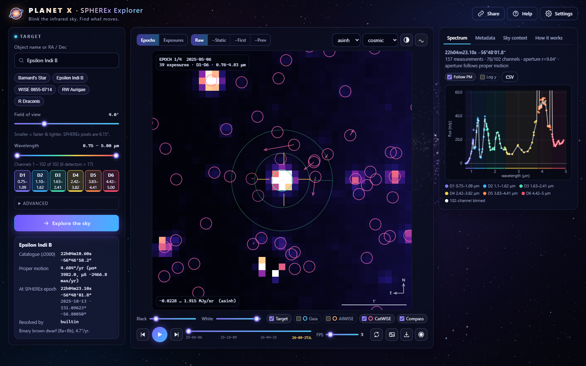
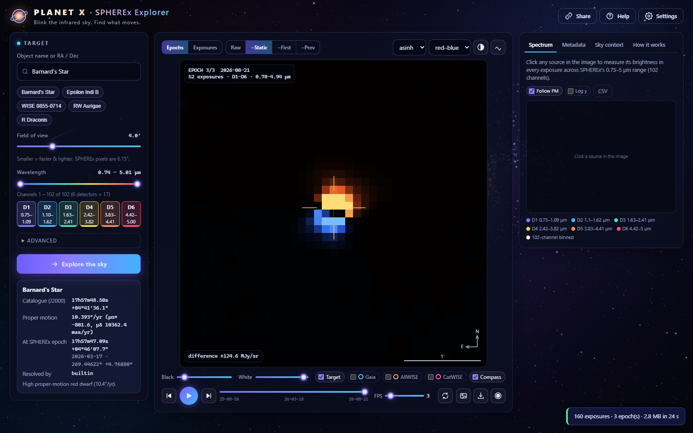

# Planet X · SPHEREx Explorer

**NASA Space Apps Challenge 2026: "Planet X and SPHEREx".**
A light, portable web tool that takes sky coordinates or an object name, pulls the matching time series of
**real NASA SPHEREx images**, and plays them as a time-lapse. Asteroids, brown dwarfs, high-proper-motion
stars and variable stars stand out against the fixed background. Click any source to get its
0.75–5 µm infrared spectrum across SPHEREx's 102 channels.





---

## Quick start

| OS | Command |
|---|---|
| Windows | double-click **`run.bat`** |
| macOS / Linux | `sh run.sh` |
| Manual | `python -m venv .venv` → `.venv/bin/pip install -r requirements.txt` → `.venv/bin/python -m backend` |

The first start creates a private virtual environment and installs **5 packages**
(astropy, numpy, fastapi, uvicorn, httpx). It then opens <http://127.0.0.1:8000/> in your browser.
Requires **Python 3.10+** and an internet connection, because the data streams live from NASA/IPAC.

Options: `python -m backend --port 9000 --host 0.0.0.0 --no-browser`.

Shareable links work the way the challenge brief describes. For example,
`http://127.0.0.1:8000/?ra=133.795&dec=-7.245&fov=4` or
`http://127.0.0.1:8000/?q=WISE%200855&det=56&diff=static` reproduce a view exactly, including display settings.

## What you can do

* **Search** by name (CDS Sesame/SIMBAD, with mirrors) or by RA/Dec in decimal or sexagesimal.
  The five mandatory test targets are one-click presets and also work offline.
* **Blink epochs.** Exposures are grouped into visits (SPHEREx revisits each field every ~6 months),
  stacked, and played with play/pause, frame stepping, a dated scrubber, 1–30 fps and loop or bounce.
* **Difference imaging**: *−Static* subtracts the per-pixel median of all frames, so fixed stars cancel and
  movers show up as black/white pairs. *−First* and *−Prev* subtract the first or the previous frame.
* **Exposure mode** blinks every single exposure, for fast movers such as asteroids that shift within a visit.
* **Band selection**: a 102-channel wavelength range slider plus detector toggles D1–D6.
  Example: WISE 0855 is only visible beyond ~3.8 µm, so select D5 + D6.
* **On-the-fly spectrum**: click a source. The tool runs aperture photometry on every exposure; SPHEREx's
  linear-variable filters give each exposure a different wavelength. The result is plotted per exposure and
  binned into the 102 official channels. The aperture can follow the target's proper motion. Export to CSV.
* **Multi-mission context**: Gaia DR3, AllWISE and CatWISE2020 sources drawn on the frames, each propagated to
  the frame's date with its proper motion, plus 10-year motion arrows for fast movers. A lazily loaded
  Aladin Lite atlas (DSS2 / 2MASS / AllWISE / SPHEREx DR1 cube, via NASA IRSA mirrors) shows the field.
* **Metadata and contamination flags**: per frame you get date span, detectors, wavelengths, sky background
  (zodiacal light), noise, coverage and the fraction of rejected (cosmic-ray) pixels. With
  *Pixel-quality flags* enabled you also get SPHEREx FLAGS: masked bad pixels, GHOST/STREAK/HALO/…
  fractions, and the flags at the target.
* **Export**: PNG frame, FITS frame (with WCS), WebM video of the time-lapse (handy for the 30-second demo
  video), spectrum CSV.
* **Galaxy UI**: animated spiral-galaxy background that adapts to the device, pauses in hidden tabs, respects
  *reduce motion*, and can be turned off in Settings. Works on desktop and phone.

Keyboard: `Space` play · `←/→` step · `D` difference mode · `M` epochs/exposures · `I` invert · `+/−/0` zoom · `?` help.

## Validation against the mandatory targets

`python tools/validate_targets.py` runs the full pipeline on the live archive and writes
[`VALIDATION.md`](VALIDATION.md). Results (4′ field, default settings):

| Target | Result |
|---|---|
| Barnard's Star | detected in every epoch; **moved 10.4″ in one year (catalogue proper motion predicts 10.2″)** |
| Epsilon Indi B | detected in every epoch; **moved 6.3″ (predicted 6.5″)**; T-dwarf spectrum with CH₄/H₂O bands |
| WISE 0855−0714 (D5+D6) | detected at S/N up to 34; **moved 8.2″ (predicted 8.0″)**; flux rises steeply towards 4.5 µm, as expected for a Y dwarf |
| RW Aurigae | detected; aperture flux varies ×1.5 between epochs |
| R Draconis | detected; core saturated in most epochs (very bright Mira variable); brightest unsaturated pixel varies ×1.2 |

> **Note on WISE 0855.** The coordinates in the challenge brief (08ʰ55ᵐ10.83ˢ −07°14′42.5″) are its ~2010
> position. At 8.1″/yr it has moved about 2.1′ by the SPHEREx era. Searching by **name** propagates the position
> automatically. Typing the old coordinates triggers a warning that points to where it is now.

## Architecture

```
 Browser (vanilla ES modules, no build step, ~120 KB)                       Python backend (FastAPI, 1 process)
 ┌──────────────────────────────────────────────┐   POST /api/jobs    ┌──────────────────────────────────────────────────────┐
 │ Module A  search / URL state / presets       │ ──────────────────► │ resolver.py  name→coords (Sesame + mirrors, built-ins) │
 │ Module C  canvas viewer: stretch, colormaps, │   poll progress     │              proper-motion propagation to data epoch   │
 │           difference imaging, overlays,      │ ◄────────────────── │ archive.py   IRSA SIA v2 → list of SPHEREx exposures   │
 │           player, zoom/pan, PNG/FITS/WebM    │   frames.bin        │ fitsrange.py HTTP range reads of each 65 MB file:      │
 │ Module D  spectrum chart, catalogue overlays,│   (float32)         │              header + WCS-WAVE + only needed pixels    │
 │           metadata, Aladin (lazy)            │   /spectrum         │ processing.py SIP-WCS reprojection, background, stacks,│
 │ galaxy.js adaptive animated background       │   /catalog          │              epochs, 102-channel spectra               │
 └──────────────────────────────────────────────┘                     │ jobs.py      async job queue, disk + memory caches     │
                                                                      │ catalogs.py  Gaia / AllWISE / CatWISE (VizieR mirrors) │
                                                                      └──────────────────────────────────────────────────────┘
```

### Optimisation decisions (low RAM, low bandwidth, low CPU)

| Decision | Effect |
|---|---|
| **Partial FITS reads** instead of the IRSA cutout service. The cutout service returns all 7 extensions, including a ~4 MB PSF table, per cutout. This tool fetches the header, the tiny wavelength table and *only the needed pixel columns of each row* (one multipart range request). | ~**35–60 KB per exposure** instead of ~4 MB; a 160-exposure query reads 5–10 MB. Verified bit-identical to the official cutouts. |
| Row-tiled RICE **FLAGS decoded from just the needed tiles**, rebuilt as a minimal FITS in memory and decoded by astropy's public API. Optional, because flags cost about 7× more data. | Quality flags without downloading the 11 MB flag extension. |
| S3 mirror (`nasa-irsa-spherex`) as automatic fallback; responses are streamed and **aborted if a server ignores `Range`**. | A 65 MB file can never be downloaded by accident. |
| Header/WCS cache on disk; finished results cached as `.npy` and **memory-mapped** when spectra are requested. | Repeat queries take 3–8 s; RAM stays flat. |
| One worker process, 2 CPU threads, bounded HTTP concurrency, ≤ 2 jobs at once, LRU limits on everything. | **Measured: 82 MB idle, ~140 MB peak** while processing 200 exposures. |
| All display maths (stretch, colour, difference images, overlays) runs in the browser on float32 frames. | Every slider responds instantly with no server round-trip; frames for a 4′ field are ~6 KB each. |
| No frontend framework or build step; Aladin Lite (~2 MB, WebGL) loads only on request. | Initial page ≈ 120 KB of HTML/CSS/JS. |
| Galaxy background: pre-rendered sprites, typed arrays, frame-rate cap, reduced internal resolution, 3 quality tiers chosen from `deviceMemory`/cores, paused when hidden. No `backdrop-filter`. | Smooth on low-end machines; can be switched off. |

### Science choices

* Exposures are resampled onto a north-up TAN grid using each file's full SIP-distortion WCS (bilinear,
  NaN-aware). Surface brightness stays in MJy/sr.
* Background (zodiacal light + sky) is removed per exposure with an iterative clipped median.
* **Consistent band weighting.** A star's brightness changes strongly between 0.75 and 5 µm. Each detector
  is therefore stacked on its own (inverse-variance weights, per-pixel outlier rejection), and detectors are
  then averaged with equal weight using the same detector set in every epoch. Frames missing a detector are
  flagged ⚠ on the timeline, so brightness changes between epochs are not artefacts of a different mix of bands.
* Spectra use a 1.6-pixel (≈10″) aperture with a local background annulus. Fluxes are in mJy **without
  aperture correction**. Saturated or incomplete apertures are skipped and counted.
* Channel wavelengths come from each exposure's own spectral WCS (`WCS-WAVE` lookup table) at the clicked
  position. Binning uses the 102 official SPHEREx channel centres.

## REST API

| Endpoint | Purpose |
|---|---|
| `GET /api/config` | detectors, 102 channels, limits, built-in targets |
| `GET /api/resolve?q=` | name/coordinate resolution (+ position now) |
| `POST /api/jobs` | `{query, fov_arcmin, lam_min, lam_max, detectors, max_exposures, epoch_gap_days, flags}` |
| `GET /api/jobs/{id}` | progress; when done, full metadata (epochs, exposures, warnings, stats) |
| `GET /api/jobs/{id}/frames.bin?mode=epoch\|exposure` | little-endian float32 frames, north up |
| `GET /api/jobs/{id}/spectrum?x=&y=&frame=&mode=&follow=` | aperture spectrum at a display pixel |
| `GET /api/jobs/{id}/fits?frame=&mode=` | frame as FITS with WCS |
| `GET /api/catalog?cat=gaia\|allwise\|catwise&ra=&dec=&radius=` | context catalogue cone |

Interactive docs: `/api/docs`. Limits are set in `backend/config.py` and can be overridden with environment
variables such as `PX_MAX_FOV_ARCMIN=8` or `PX_HTTP_CONCURRENCY=8`.

## Tests

```
python tests/test_core.py        # or: python -m pytest -q
python tools/validate_targets.py # live end-to-end check of the 5 targets (needs internet)
```

The offline unit tests cover:
* coordinate parsing and name aliases;
* proper-motion propagation, checked against astropy `apply_space_motion` and Gaia DR3;
* the range reader and RICE flag decoding, checked against astropy on a synthetic multi-extension FITS;
* multipart parsing, resampling, robust statistics, epoch grouping, outlier rejection, band-consistent
  stacking, channel binning and the VizieR parser;
* the browser's JavaScript TAN projection, checked against astropy WCS.

## Notes and limitations

* Needs internet: all data streams live from NASA/IPAC IRSA (and its AWS mirror). Catalogue overlays use
  CDS VizieR mirrors (Harvard CfA, IDIA) because the main CDS site may be unavailable.
* Departures from the suggested stack, made deliberately for portability and low RAM: plain ES modules
  instead of React + Tailwind (no Node toolchain or build step), and direct IVOA SIA/HTTP calls instead of
  astroquery (one heavy dependency fewer). Astropy is still used for FITS, WCS and VOTable work.
* SPHEREx pixels are 6.15″. Motions below about 1″ per epoch gap are at the limit of what centroids can measure.
* SPHEREx data: NASA/JPL-Caltech/IPAC. Gaia: ESA/DPAC. WISE/NEOWISE: NASA/JPL. VizieR, Sesame and
  Aladin Lite: CDS Strasbourg.
